<a id="topo"></a>

<p align="center">
  <a href="https://arthurhecker.space">
    
  </a>
</p>

<p align="center">
  <a href="https://arthurhecker.space"></a>
  <a href="https://www.linkedin.com/in/arthur-hecker-silva/"></a>
  <a href="https://www.instagram.com/thur_hecker/"></a>
</p>

<br>


<p align="center">
  
</p>

<details>
<summary><b>Ler sem animação</b> <sub>(sobre.txt)</sub></summary>
<br>

- **Nome:** Arthur Hecker
- **Estudo:** Engenharia da Computação na Faculdade Galileu e Ciência de Dados na Univesp
- **Faço:** sites, sistemas, bots e servidores, de ponta a ponta
- **Integro:** APIs de pagamento (Stripe, Asaas), WhatsApp (Meta), Google APIs, TOTVS Protheus e Rastron (rastreamento de veículos)
- **Gosto de:** web, 3D no navegador, dados e IA
- **Servidor:** um Linux só meu, que eu mesmo administro (sim, às 3h)
- **Status:** compilando... com café

</details>

<br>



<p align="center">
  
</p>

<br>


<p align="center">
  <br>
  <br>
  
</p>

<p align="center">
  
</p>

<br>


<p align="center">
  
</p>

<p align="center">
  
</p>

<p align="center">
  
</p>

<br>


<p align="center">
  <a href="https://arthurhecker.space"></a>
  <a href="https://www.linkedin.com/in/arthur-hecker-silva/"></a>
  <a href="https://www.instagram.com/thur_hecker/"></a>
  <a href="#topo"></a>
</p>

<p align="center">
  <a href="https://arthurhecker.space"></a>
</p>

<details>
<summary><sub>☕ não abra isto às três da manhã</sub></summary>
<br>

```text
     ( (
      ) )          > git commit -m "último bug do dia"
   ........        > git commit -m "agora sim, o último"
   |      |]       > git commit -m "ok, ESTE é o último"
   \      /        > git commit -m "..."
    `----'         > git push --force   # brincadeira
```

</details>
