<a id="topo"></a>

<p align="center">
  <a href="https://arthurhecker.space">
    
  </a>
</p>

<p align="center">
  <a href="https://arthurhecker.space"></a>
  <a href="https://www.linkedin.com/in/arthur-hecker-silva/"></a>
  <a href="https://www.instagram.com/thur_hecker/"></a>
  <a href="https://arthurhecker.space"></a>
</p>

<p align="center">
  
  
  
</p>

<p align="center"><b>☰ &nbsp;C A P Í T U L O S</b></p>

<p align="center">
  <a href="#cap-1">I · Três da manhã</a> ·
  <a href="#cap-2">II · Um chat comigo mesmo</a> ·
  <a href="#cap-3">III · O bug do Newton</a> ·
  <a href="#cap-4">IV · O arcade</a><br>
  <a href="#cap-5">V · O PC superaqueceu</a> ·
  <a href="#cap-6">VI · Voltei a trabalhar</a> ·
  <a href="#cap-7">VII · Os atalhos</a>
</p>

<br>

<a id="cap-1"></a>


<p align="center">
  
</p>

<details>
<summary><b>Ler sem animação</b> <sub>(sobre.txt)</sub></summary>
<br>

- **Nome:** Arthur Hecker Silva
- **Estudo:** Engenharia da Computação na Faculdade Galileu (2023–2027) e Ciência da Computação na Univesp (2024–2028)
- **Faço:** sites, bots, jogos e servidores, de ponta a ponta: do modelo 3D ao `systemctl restart`
- **Servidor:** um Linux só meu, que eu mesmo administro (sim, às 3h)
- **Agora:** o jogo *Formigas no Piquenique*, em Godot
- **Status:** compilando... *(eu não estava dormindo!)*

</details>

<br>

<a id="cap-2"></a>


<p align="center">
  <a href="https://arthurhecker.space">
    
  </a>
</p>

> [!TIP]
> O chat de verdade fica no **[arthurhecker.space](https://arthurhecker.space)**: lá uma IA responde como se fosse eu (paranoia? certamente é o Arthur).
> Para falar comigo mesmo, o caminho é o **[LinkedIn](https://www.linkedin.com/in/arthur-hecker-silva/)** ou o **[Instagram](https://www.instagram.com/thur_hecker/)**.

<br>

<a id="cap-3"></a>


<p align="center">
  
</p>

| | Curso | Onde | Quando |
|:-:|---|---|:-:|
| 🎓 | **Engenharia da Computação** | Faculdade Galileu | 2023 – 2027 |
| 🎓 | **Ciência da Computação** | Univesp | 2024 – 2028 |
| 🍎 | **Física aplicada a bugs** | a madrugada | desde sempre |

<br>

<a id="cap-4"></a>


<p align="center">
  <a href="https://arthurhecker.space">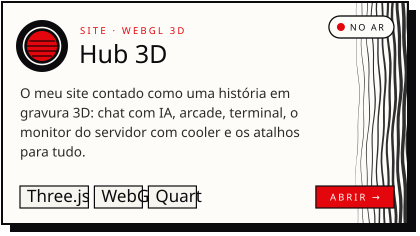</a>
  <a href="https://arthurhecker.space/morde">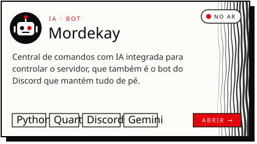</a>
  <a href="https://pyro.arthurhecker.space">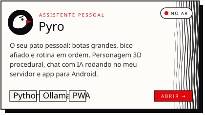</a>
  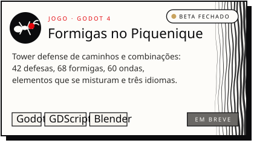
  <a href="https://github.com/ArthurHecker/Projeto-Integrador-1">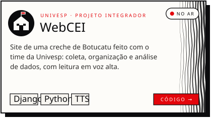</a>
  <a href="https://arthurhecker.space/jogovelha">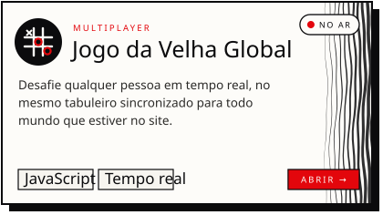</a>
  <a href="https://arthurhecker.space/dontpad">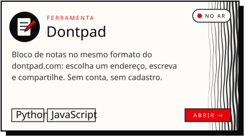</a>
  <a href="#cap-5">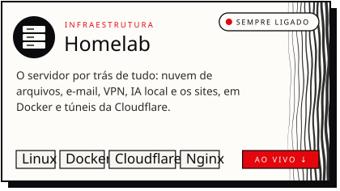</a>
</p>

<p align="center"><sub><b>…e no meio do arcade, a cobra começou a comer os meus commits:</b></sub></p>

<p align="center">
  <picture>
    <source media="(prefers-color-scheme: dark)" srcset="https://raw.githubusercontent.com/ArthurHecker/ArthurHecker/output/cobra-escura.svg">
    
  </picture>
</p>

<details>
<summary><b>Mais coisas no arcade</b> <sub>(repositórios públicos e jogos do site)</sub></summary>
<br>

| Repositório | O que é |
|---|---|
| [Projeto-Integrador-1](https://github.com/ArthurHecker/Projeto-Integrador-1) | O WebCEI, projeto integrador da Univesp com uma creche de Botucatu |
| [aula_bd](https://github.com/ArthurHecker/aula_bd) | Banco de dados: modelagem, scripts SQL, consultas e exercícios |
| [Ressurge](https://github.com/ArthurHecker/Ressurge) | Site para a Ressurge |

No **[arcade do site](https://arthurhecker.space)** dá para jogar **Dino**, **Pac-Man**, **Snake** e **Memória**…
só que o pesadelo vai junto: o dino vira o rapaz do sonho, o Pac-Man ganha o rosto dele e a cobra manda acordar.

</details>

<br>

<a id="cap-5"></a>


<p align="center">
  
</p>

<p align="center">
  
</p>

<details>
<summary><b>Como isso funciona?</b> <sub>(spoiler: o cooler é de verdade, mais ou menos)</sub></summary>
<br>

A cada 3 horas, um [GitHub Actions](.github/workflows/vivo.yml) roda [`live.py`](.github/scripts/live.py) e redesenha estas artes:

- **Cooler:** começa em 800 RPM e ganha **+120 RPM por commit** dos últimos 30 dias (no máximo 6.000). Commitou demais? Superaqueceu.
- **Números:** contribuições, sequências, repositórios e estrelas, lidos do próprio GitHub.
- **Sites no ar:** o Actions faz uma requisição a cada site e mede a latência. Se algum cair, ele aparece em vermelho.
- **Gravura:** o calendário de contribuições vira gravura, igual às do site: cada linha vertical é uma semana e a espessura mostra os commits de cada dia. O círculo vermelho marca o dia mais produtivo (ou o mais desesperado).
- **Cobra:** gerada pelo [Platane/snk](https://github.com/Platane/snk) com as cores do site.

Nada aqui é inventado: se uma leitura falhar, o quadro mostra "sem leitura" até a próxima rodada.

</details>

<br>

<a id="cap-6"></a>


<p align="center">
  <br>
  <br>
  
</p>

```console
C:\Users\arthur> arthur --help
```

| Comando | O que acontece |
|---|---|
| [`arthur --chat`](https://arthurhecker.space) | conversa com a IA que jura ser eu |
| [`arthur --arcade`](https://arthurhecker.space) | Dino, Pac-Man, Snake e Memória (com pesadelos inclusos) |
| [`arthur --velha`](https://arthurhecker.space/jogovelha) | jogo da velha contra qualquer pessoa, em tempo real |
| [`arthur --dontpad`](https://arthurhecker.space/dontpad) | bloco de notas compartilhado, sem cadastro |
| [`arthur --pyro`](https://pyro.arthurhecker.space) | chama o pato |
| [`arthur --classico`](https://arthurhecker.space/old) | a versão clássica do hub (mais leve, sem 3D) |
| [`arthur --dormir`](#cap-1) | `ERROR: comando não encontrado` |

<br>

<a id="cap-7"></a>


<p align="center">
  <a href="https://arthurhecker.space"></a>
  <a href="https://www.linkedin.com/in/arthur-hecker-silva/"></a>
  <a href="https://www.instagram.com/thur_hecker/"></a>
  <a href="#topo"></a>
</p>

<p align="center">
  <a href="https://arthurhecker.space"></a>
</p>

<details>
<summary><sub>🌙 não abra isto às três da manhã</sub></summary>
<br>

```text
          .-""""-.
        .'  .--.  '.        Ei, Arthur...
       /   (    )   \
      |     '--'     |      Acorde.
       \    .--.    /
        '. (    ) .'        Você ainda tem muito trabalho a fazer...
          '-....-'
     ___|___|___|___|___
        |   |   |   |       > git commit -m "último bug do dia"
                            > git commit -m "agora sim, o último"
                            > git commit -m "ok, ESTE é o último"
```

</details>

<!-- artes: tools/build.py (fixas) e .github/workflows/vivo.yml (ao vivo). Fontes OFL em tools/fonts. -->
